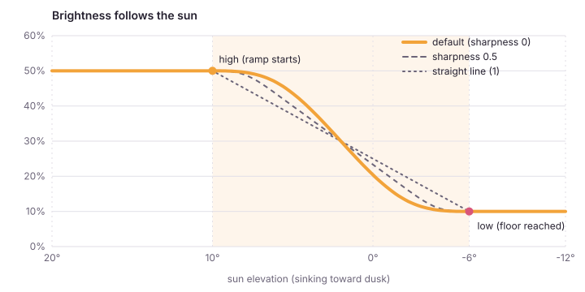

  <picture>
    <source media="(prefers-color-scheme: dark)" srcset="custom_components/duskylights/brand/dark_icon@2x.png">
    
  </picture>

<h1 align="center">Dusky Lights</h1>

  Dims your lights along the sun's elevation: a set level during the day, a
  smooth ease down to a lower level at dusk, and back up at dawn.

  
  
  

  <picture>
    <source media="(prefers-color-scheme: dark)" srcset="assets/curve-dark.svg">
    
  </picture>

## What it does

| | |
|---|---|
| **Follows the sun, not the clock** | The ramp is defined by sun *elevation*, so it shifts with the seasons by itself. Default: starts at +10°, floor reached at -6°. |
| **Never brightens on you** | Dim a light by hand and it stays where you put it until the sun catches down, or you turn it off and on. |
| **Set it once, tune per room** | Global high and low, with per-room overrides. Overrides of 0 mean "use the global value". |
| **Shape the curve** | A sharpness control at each end, from soft to abrupt. |
| **Smooth** | Sun elevation is interpolated between updates; changes are applied in about 1 % steps. |
| **Try it fast** | Demo mode plays a whole day's sun, for today's date, over a few minutes on a single light. |
| **Plain Home Assistant** | Only `light` entities and the built-in `sun` integration. Nothing to flash. |

**Status: early development.** It passes its tests in Home Assistant's own test
harness (config flow, entities, curve, holds, release, overrides, demo) but has
not yet been run against real lights. Treat it as pre-release.

## Install (HACS)

1. HACS → ⋮ → **Custom repositories** → add
   `https://github.com/InternetofAwesome/duskylights`, category **Integration**.
2. Download **Dusky Lights** in HACS, then restart Home Assistant.
3. Settings → Devices & services → **Add integration** → Dusky Lights, and pick
   the lights to manage. (Start with one.)

## Entities

Each managed light gets its own device, "Dusky <light name>", so ids stay short:
`number.dusky_<light>_high`, `number.dusky_<light>_low`,
`button.dusky_<light>_release`, `sensor.dusky_<light>_target`. Global settings
live on the "Dusky" device: `number.dusky_high`, `number.dusky_low`,
`number.dusky_start_elevation`, `number.dusky_end_elevation`,
`number.dusky_start_sharpness`, `number.dusky_end_sharpness`,
`button.dusky_release_all`, `sensor.dusky_sun_elevation`.

- Numbers (global): start/end elevation, high (normal) and low (minimum)
  brightness, sharpness at each end.
- Numbers (per light): high / low override. **0 = use the global value.**
- Buttons: release one light, or all, back onto the curve.
- Sensors: each light's target brightness (with `holding`, `hold_brightness` and
  `demo` attributes) and the interpolated sun elevation in use.

## Design

- Each light sits at a "normal" brightness; as the sun drops through a window of
  elevations it eases down to a "minimum". Defaults: ramp starts at +10°, floor
  reached at -6° (end of civil twilight). Dawn is the mirror image.
- The curve is a cubic Hermite with a **sharpness** at each end: 0 = soft, 1 =
  straight line, up to 3 = steep (never overshoots).
- Global defaults, with optional per-room overrides (0 = use the global value).
- Manual changes: dimming by hand holds that level until the sun's target falls
  below it; raising by hand holds until the light is turned off and on, or dawn.
  Release buttons put a room (or all rooms) back on the curve.
- The sun entity updates only every few minutes, so elevation is interpolated
  between readings and changes are applied in ~1 % steps.
- No firmware or add-on dependencies: it only uses standard `light` entities and
  Home Assistant's built-in `sun` integration.

## Development

    python3 -m venv .venv && .venv/bin/pip install pytest-homeassistant-custom-component
    .venv/bin/python -m pytest -q
    ruff check . && ruff format --check .

## Demo mode

Plays one compressed cycle of the real sun for today's date (or any `date`) on
exactly **one** light: the dusk ramp, the dawn ramp, and a short hold on each
flat stretch between. With the default length it is the shortest cycle in which
no step changes the brightness by more than about 1 %: about 15 s per ramp at
the default settings, 30-35 s in all. Sharper curves take longer. The light is
put back as it was when the demo ends.

From the UI (device "Dusky"): choose **Demo light**, **Demo repeat** (Once or
Loop) and **Demo length** (seconds, 0 = automatic), then turn on **Demo**.
Turning it off stops it.

From automations: `duskylights.demo` with `entity_id` (one light), optional
`seconds`, `date` and `loop`; `duskylights.demo_stop` ends it.

## License

Copyright (c) 2026 InternetofAwesome.
[GNU AGPL-3.0](LICENSE). Free to use, modify and share, provided the copyright
notice is kept and any distributed or network-served modified version is
published under the same license with its source.
